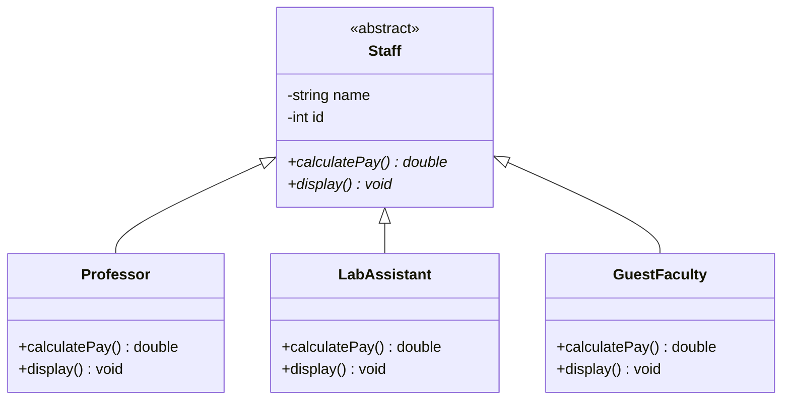
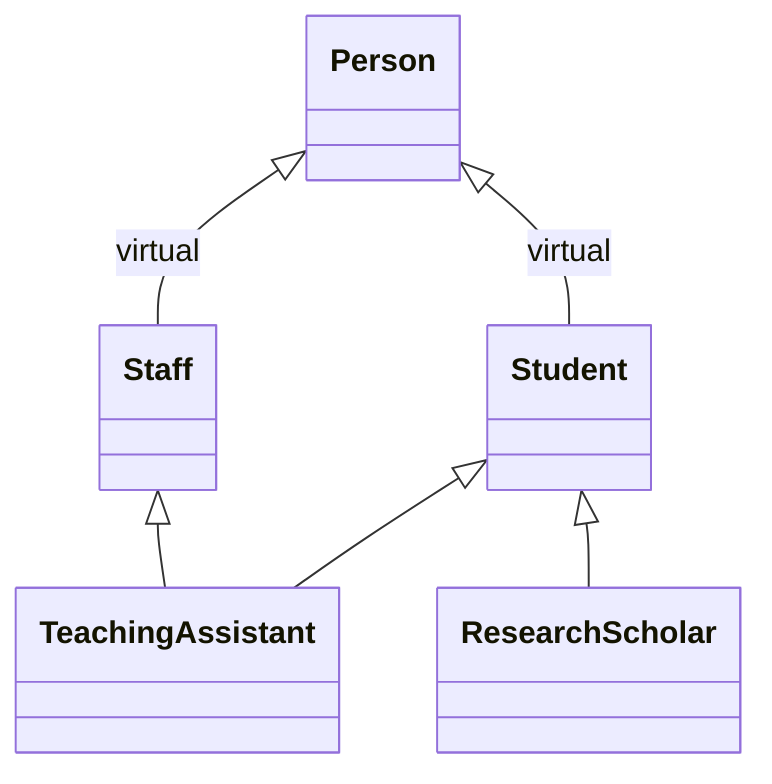
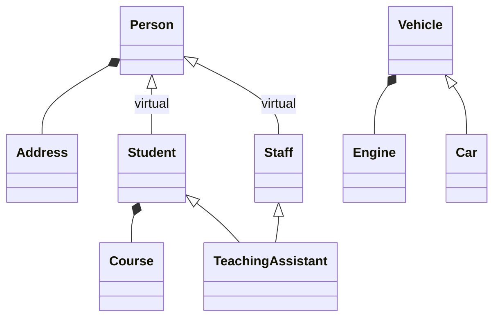
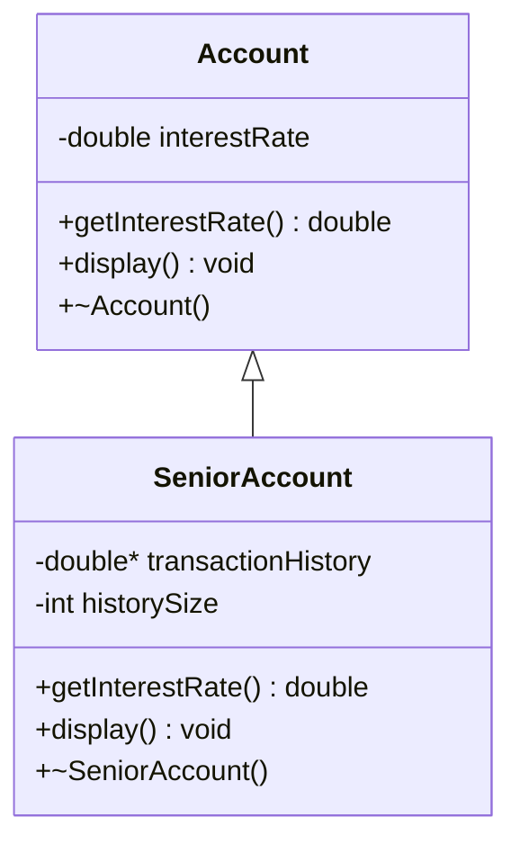
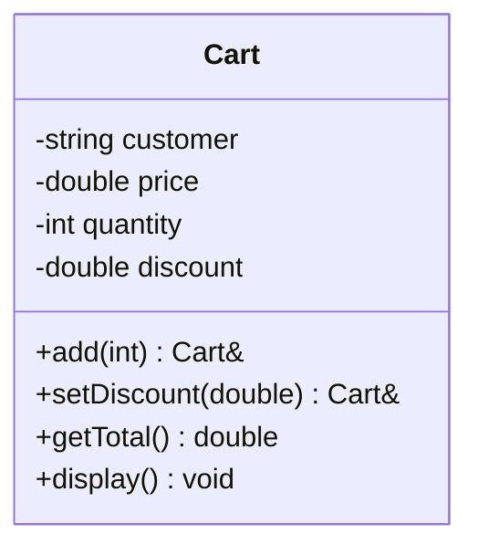
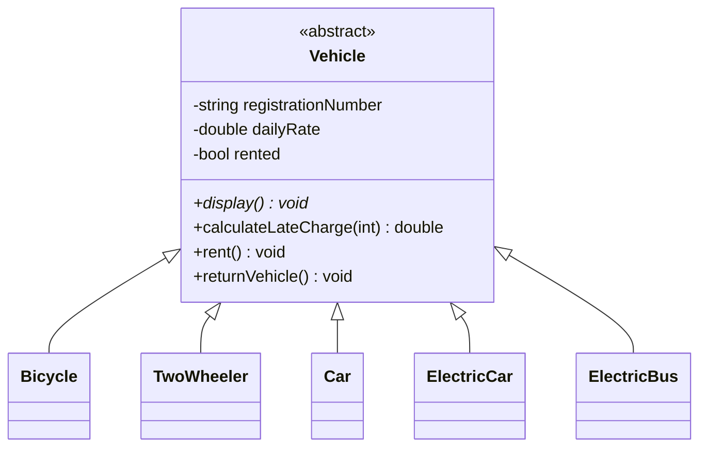

# Assignment 4 – UML Class Diagrams

These diagrams represent the major class relationships used in the six assignment tasks.

## Task 1 – Staff Hierarchy

## Task 2 – Inheritance Hierarchy

## Task 3 – Composition and Inheritance

## Task 4 – Account Hierarchy

## Task 5 – Cart Class

## Task 6 – Vehicle Rental Fleet

**Note:** These diagrams represent the principal class relationships. Member details are abbreviated for readability.